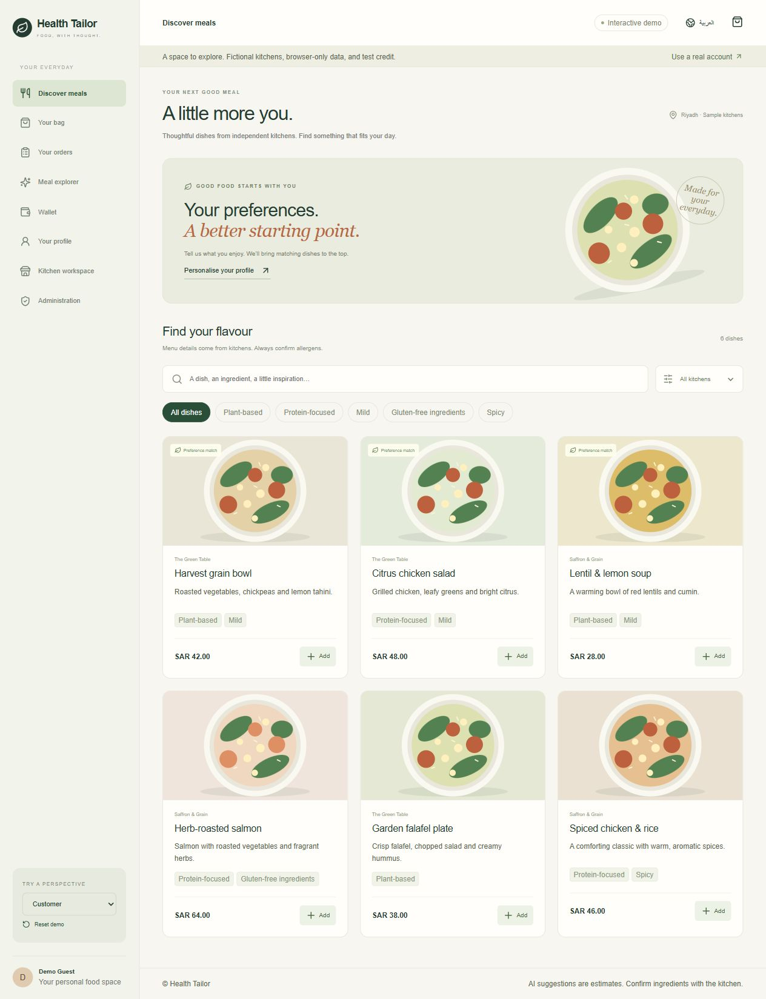

# Health Tailor

**Thoughtful food discovery, from personal preferences to the kitchen.**

[](https://github.com/MuhammadBilal0021/Health-Tailor/actions/workflows/ci.yml)


Health Tailor is my graduation project exploring a practical problem: food ordering is easy, but understanding how a meal fits your preferences is often harder. It brings ingredient information, preference-based discovery, restaurant operations, and order tracking into one application.

The current version rebuilds the original Flask/Firebase prototype as a **Next.js + TypeScript frontend and a FastAPI + PostgreSQL backend**, with an English/Arabic interface and a no-sign-up interactive demo. The original implementation remains on the [legacy-flask branch](https://github.com/MuhammadBilal0021/Health-Tailor/tree/legacy-flask).

[Run locally](#quick-start) · [Deploy on Vercel](docs/DEPLOYMENT.md) · [Architecture](docs/ARCHITECTURE.md) · [Interview summary](docs/PROJECT-SUMMARY.md)



## What you can try

| Customer | Restaurant | Administrator |
| --- | --- | --- |
| Search meals, ingredients, and kitchen menus | Add, edit, and hide dishes | Approve or pause kitchens |
| Rank meals by personal preferences | Maintain bilingual kitchen details | Approve or reject credit requests |
| View declared ingredients and allergens | Advance orders through fulfillment | Inspect order activity |
| Place orders and track progress | See settled order revenue | Review role-separated operations |
| Request test credit and view refunds | Read delivered-order reviews | Keep approvals explicit |
| Review delivered orders | Switch between fictional demo kitchens | Explore without creating an account |

English/Arabic switching changes layout direction and SAR formatting. Optional AI meal exploration accepts a question and a food image with explicit consent; it is disabled in browser demo mode and returns an honest unavailable message when no provider is configured.

**This is a portfolio prototype.** Its credit ledger does not process real payments. Menu data is fictional, preference matching is not a medical recommendation, and AI cannot verify allergens or provide clinical dietary advice. No real customer adoption or health outcomes are claimed.

## A two-minute walkthrough

1. Open **Discover meals**, choose a dish, and add it to your bag.
2. Enter a fictional delivery address and place the order using the demo's SAR 500 test credit.
3. Open **Kitchen workspace**, choose the relevant demo kitchen, and advance the order through confirmed → preparing → ready → delivered.
4. Return to **Your orders** and leave a review.
5. Request credit in **Wallet**, then switch to **Administrator** to approve it.
6. Try **العربية**, then use **Reset demo** to start again.

Demo state stays in your browser. It never grants live server permissions. Live accounts use server-enforced roles and start with zero credit.

## Engineering decisions

- **Typed UI:** strict TypeScript models, reusable React components, accessible labels, keyboard focus, native dialogs, and responsive CSS.
- **Server-owned pricing:** clients submit dish IDs and quantities; the API calculates totals in integer halalas and snapshots order prices.
- **Transactional ordering:** PostgreSQL row locks serialize wallet updates; idempotency keys prevent duplicate checkout charges; refunds and restaurant settlement happen once.
- **Explicit authorization:** opaque HttpOnly session cookies, hashed session tokens, CSRF verification, role and ownership checks, and bounded request schemas.
- **Reproducible delivery:** Alembic schema migrations, Docker Compose, locked frontend dependencies, Python checks, and GitHub Actions with a PostgreSQL test service.
- **Honest AI integration:** server-side credentials, opt-in requests, validated image uploads, rate limiting, and no fabricated fallback analysis.

See [architecture and tradeoffs](docs/ARCHITECTURE.md) for details and [security notes](SECURITY.md) for current limits.

## Quick start

Requires Node.js 22 and npm. The interactive demo does not require Python, a database, or API credentials.

```bash
cd frontend
npm ci
npm run dev
```

Open [localhost:3000](http://localhost:3000). For a portfolio deployment, import this repository into Vercel and set **Root Directory to `frontend`**. Keep `NEXT_PUBLIC_API_ENABLED=false`. See the [deployment guide](docs/DEPLOYMENT.md) for live accounts and database setup.

### Full stack with Docker

Requires Docker Compose. Copy the root `.env.example` to `.env` and set a unique URL-safe `POSTGRES_PASSWORD`.

```bash
docker compose up --build -d
docker compose exec backend python manage.py seed-catalog
docker compose exec backend python manage.py create-user --email admin@example.test --name Admin --role admin
docker compose exec backend python manage.py create-user --email kitchen@example.test --name "Demo Kitchen" --role restaurant --kitchen r1
```

The CLI asks for passwords privately; there are no shared default credentials. Sign up as a customer in the UI, request credit, and approve it using your administrator account. The sample catalog creates fictional kitchens but no owners or balances. Docker's insecure-cookie setting is for localhost only. A native Python setup is documented in [deployment](docs/DEPLOYMENT.md).

## Validation

```bash
# frontend/
npm run typecheck
npm test
npm run format:check
npm run build

# backend/ (Python 3.11 or 3.12, virtual environment)
pip install -r requirements-dev.txt
ruff check .
ruff format --check .
python -m pytest -q
```

Frontend tests cover totals, availability, insufficient credit, refunds, settlement, and repeated approvals. API tests cover authentication, CSRF, ownership, invalid transitions, server-side pricing, replayed requests, reviews, and unavailable AI. CI runs the backend suite on PostgreSQL, including concurrent checkout; SQLite skips that concurrency test locally.

Real browser checks covered checkout → delivery, desktop discovery, and Arabic mobile layout. Screenshots use fictional demo data. Docker and Vercel configuration are included; an actual cloud deployment is not implied by a passing build.

## Repository map

```text
frontend/src/app/          Next.js routes and responsive styling
frontend/src/components/   Customer, kitchen, and admin views
frontend/src/lib/          Typed state, demo catalog, and commerce rules
frontend/tests/            Domain behavior tests
backend/main.py           FastAPI endpoints
backend/commerce.py       Transactional order and credit rules
backend/models.py         SQLAlchemy relational models
backend/migrations/       Versioned Alembic schema
backend/tests/            API and PostgreSQL concurrency tests
docs/                     Deployment, architecture, and project narrative
```

## Scope and next steps

This migration implements the core discovery, ordering, kitchen, and admin workflows. It does not migrate Firebase users, passwords, photos, or PKR balances; SAR amounts are newly authored sample data. Account recovery/email verification, payment-provider reconciliation, live courier tracking, clinical nutrition validation, full error-message localization, and production observability remain future work. Live carts are held in memory and reset on a full page refresh. API history currently returns up to 200 records rather than paginated archives.

The project demonstrates a working technical approach to more informed meal discovery. Validating its impact would require interviews with diners and restaurants, usability testing, and measured outcomes.

Built by [Muhammad Bilal](https://github.com/MuhammadBilal0021).
