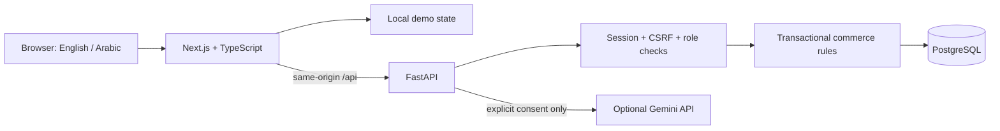
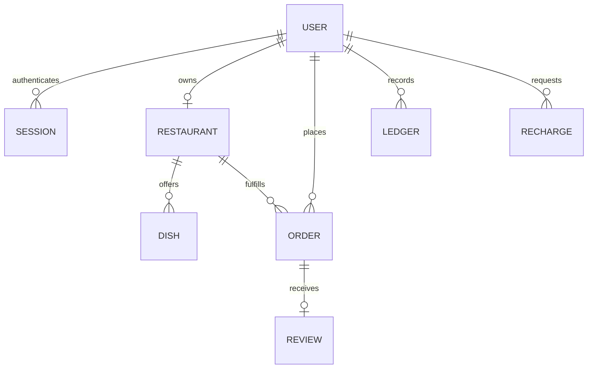
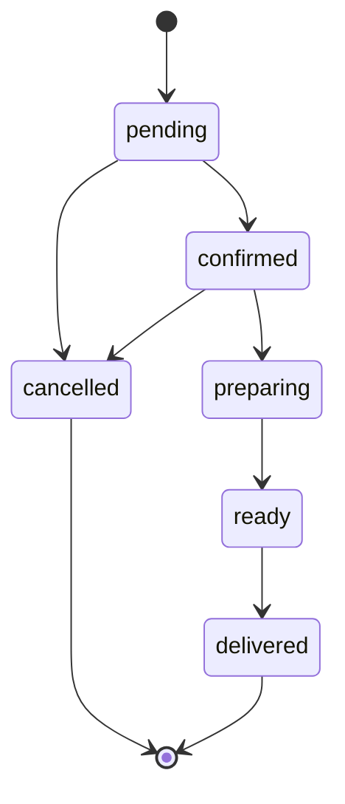

# Architecture and tradeoffs

## Two execution modes

The browser demo uses typed fixtures and pure domain functions. It has a role selector so a reviewer can follow one order from several perspectives. This selector is hidden for live accounts and never changes server-side authorization. Fictional demo profiles are stored in localStorage; live profile data is not cached there. Live authentication uses an HttpOnly cookie, not a localStorage bearer token.

The connected mode obtains the user's role and allowed data from `/api/bootstrap`. Every mutation is checked again by the API. A customer cannot approve credit, a restaurant cannot edit another kitchen, and an administrator cannot be created through public signup. Live carts remain in React memory; order history resides in PostgreSQL.

## Data model

Amounts are integer halalas. An order snapshots names, quantities, and current server prices, so later menu edits do not rewrite its history. Each order has a unique `(user_id, idempotency_key)` and a payload fingerprint. Reusing a key for a different payload is rejected.

## Transaction boundaries

Checkout locks the payer, looks for a replay, locks requested dishes and their restaurant, verifies availability, computes prices, debits credit, and records an order and ledger entry in one transaction. Concurrent purchases cannot spend the same PostgreSQL balance twice. The client retains the same idempotency key when retrying an unchanged checkout during the current session.

Status changes lock the order and validate a finite transition graph:

Cancellation refunds the full order total once. Delivery settles the dish subtotal to the restaurant once; the SAR 5 delivery fee is not restaurant revenue. Terminal status replays are harmless. Unique ledger IDs provide additional duplicate protection. This is a prototype accounting model, not a regulated wallet or payment gateway.

Credit approval locks the request and payer. It accepts only pending requests, credits once, and records a ledger entry. Request creation locks the user before checking for an existing pending request.

## Deployment

Next.js and FastAPI are independently buildable. Frontend-only Vercel deployment supports the browser demo. Root Vercel Services configuration supports both services with an external PostgreSQL database. Docker Compose supplies a local PostgreSQL service and runs migrations before the API starts.

SQLAlchemy uses short-lived sessions and no application connection pool for PostgreSQL so serverless instances do not accumulate idle connections; use a provider-managed pooler where suitable. Alembic migrations run explicitly before deploying schema-dependent code.

## Deliberate limits

This application emphasizes the core workflows over a complete production commerce platform. It has no actual card processing, SMS, email verification, account recovery, courier integration, multi-kitchen checkout, or clinical nutrition engine. API collections are capped at 200 records and do not yet implement cursor pagination. The demo and API have separate implementations of shared commerce rules; their test suites exercise equivalent invariants, but there is no generated cross-language contract yet.

The AI request includes only the submitted question, optional image, preference tags, and optional dietary considerations. It does not intentionally add name, email, order history, or address. Text supplied by the user can itself contain personal information; the consent UI describes the external processing. Images are validated in memory and not saved by this application. Provider retention is governed by the chosen provider configuration.
