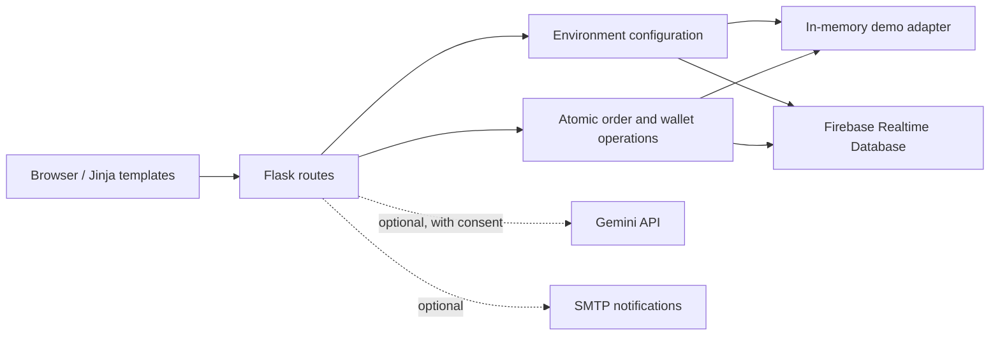

# Architecture and tradeoffs

The project retains its original Flask/Jinja routes while extracting configuration and financial state transitions into separate modules.

## Important decisions

- **Try before configuring:** demo mode starts with fictional records and no cloud access. Its data resets on restart.
- **Atomic financial changes:** checkout, recharge approval, cancellation, and settlement update their related records in a root transaction. Callbacks contain no external side effects. This prioritizes correctness for a small prototype; root transactions create contention and should be replaced with a partitioned ledger architecture before scaling.
- **Monetary calculation:** Decimal is used for calculation and rounding; values are serialized as JSON numbers for compatibility with the original database and templates.
- **Explicit uncertainty:** unavailable or malformed AI responses produce no assessment. Fixed nutrition charts were removed. Image-derived suggestions are not verified ingredients, allergy clearance, or clinical advice.
- **Email is secondary:** order state and payout do not depend on successful email delivery. Production would benefit from an outbox and retry worker.
- **Legacy compatibility:** existing Firebase paths and most screens are retained. Plaintext password records require resetting.

## Next engineering milestones

1. Split the remaining large route module into customer, restaurant, and admin blueprints.
2. Introduce a real payment provider with verified webhooks and reconciliation.
3. Add verified restaurant ingredient/allergen metadata and explicit portion sizes.
4. Expand browser accessibility and responsive-layout testing.
5. Add Arabic localization and RTL layouts if targeting Arabic-speaking users.
6. Add distributed rate limiting, audit events, and session revocation for a live deployment.

## External integration references

- [Google Gen AI Python SDK](https://googleapis.github.io/python-genai/)
- [Firebase Admin Python](https://firebase.google.com/docs/reference/admin/python)
- [Flask documentation](https://flask.palletsprojects.com/)
